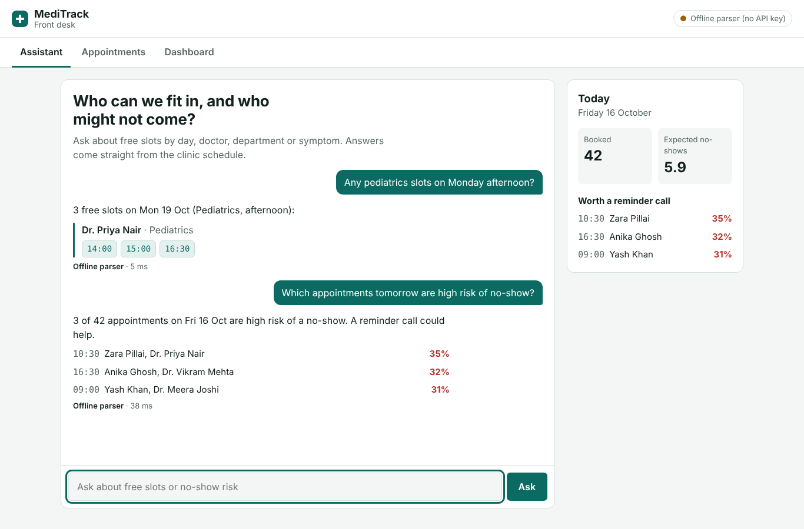
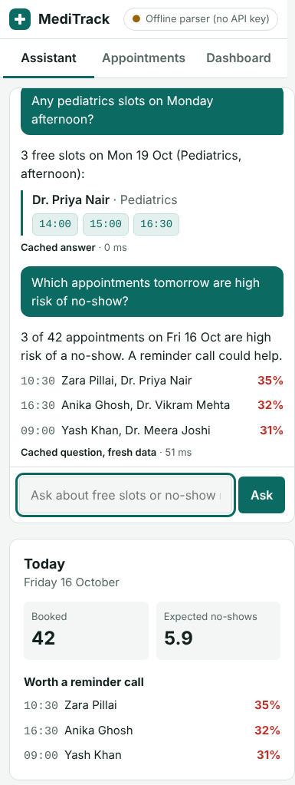
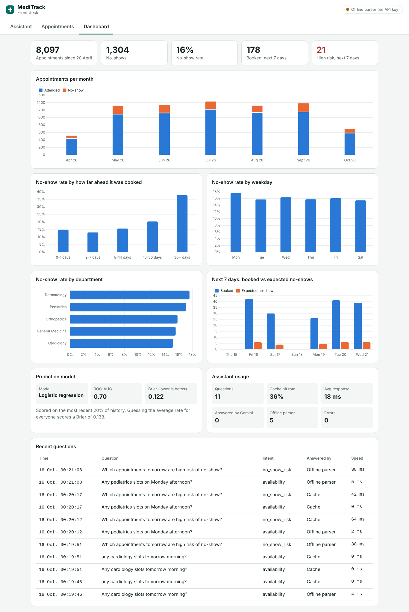
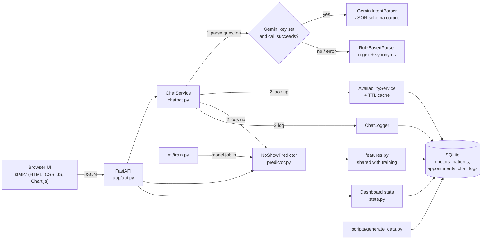

# MediTrack Front Desk

A web app for clinic receptionists that answers appointment-availability questions in plain language and flags patients who are likely not to turn up.

- **Assistant**: ask "Any cardiology slots tomorrow morning?" or "Which appointments on Monday are high risk?". Google Gemini understands the question; the answer is built from the clinic schedule, so a time slot is never invented.
- **No-show risk**: a logistic-regression model trained on six months of appointment history scores every upcoming booking (probability 0–1) and says why.
- **Dashboard**: appointments, no-shows, rates by lead time, weekday and department, the coming week, model quality and assistant usage.

| Assistant (desktop) | Phone |
|---|---|
|  |  |



---

## Quick start

Requires Python 3.11+ (developed on 3.13).

```bash
git clone <this repo> && cd meditrack
python -m venv .venv
source .venv/bin/activate          # Windows: .venv\Scripts\activate
pip install -r requirements.txt

cp .env.example .env               # Windows: copy .env.example .env
# optional: put your key from https://aistudio.google.com/apikey in GEMINI_API_KEY

uvicorn app.main:app --reload
```

Open http://localhost:8000. On first start the app generates the mock dataset (`data/meditrack.db`) and trains the model (`ml/model.joblib`), which takes a few seconds. Interactive API docs are at http://localhost:8000/docs.

**No API key?** The app still works: the assistant switches to a built-in rule-based parser and the header shows "Offline parser". With a key it shows "Gemini connected".

Other commands:

```bash
pytest -q                                    # 73 tests, no API key or network needed
python -m scripts.generate_data              # rebuild the mock data, anchored on today
python -m ml.train                           # retrain and print the model comparison
docker build -t meditrack . && docker run -p 8000:8000 --env-file .env meditrack
```

The mock schedule covers the 14 days after the day it was generated. If you come back days later, rerun the two commands above (the server logs a warning when the schedule has run out).

---

## Requirements coverage

| Requirement | Where | How to see it |
|---|---|---|
| **Must:** chatbot answers availability from a simulated dataset | `app/services/chatbot.py`, `intent.py`, `availability.py`; `POST /api/chat` | Assistant tab: "When is Dr. Rao free on Monday?" returns real free slots as chips |
| **Must:** model returns a 0–1 no-show probability for a scheduled appointment | `ml/train.py`, `app/services/predictor.py`; `GET /api/appointments/{id}/no-show-risk`, `GET /api/appointments/upcoming`, `POST /api/predict` | Appointments tab: every booking has a probability, risk band and reasons |
| **Should:** dashboard of appointments, no-shows and other statistics | `app/services/stats.py`; `GET /api/stats`; Dashboard tab | Totals, monthly attended vs no-show, rates by lead time / weekday / department, next 7 days |
| **Should:** log chatbot interactions with timestamp and query | `app/services/chat_log.py` → `chat_logs` table; `GET /api/chat/logs` | Dashboard → "Recent questions" (time, question, intent, answered by, speed) |
| **Must:** responsive on desktop and mobile | `static/app.css` (breakpoints at 960px and 640px) | Checked at 375px: no horizontal scroll on any tab |
| **Must:** architecture and trade-offs documented | This README: [Architecture](#architecture), [Decisions and trade-offs](#decisions-and-trade-offs) | |
| **Could:** cache for repeated queries | Intent cache in `chatbot.py` + slot cache in `availability.py` (TTL, `cachetools`) | Ask the same question twice: the second reply says "Cached answer" and skips the Gemini round trip (often a second or more; a few ms offline) and returns in about 1 ms |

---

## Architecture



**A chat request, step by step**

1. `POST /api/chat` validates the message (1–500 characters).
2. If the same question was asked today, its parsed intent comes from the cache and the LLM is skipped.
3. Otherwise Gemini turns the text into JSON: `intent`, `date`, `department`, `doctor`, `time_of_day`. Pydantic validates it, and names are mapped onto real departments and doctors (unknown ones are dropped). If there's no key, or Gemini times out, hits a quota, or returns bad JSON, the rule-based parser does the same job.
4. The service queries the database: free slots (through the slot cache) or high-risk bookings for that day.
5. The reply text is written by code from those results, not by the LLM.
6. The interaction is logged (timestamp, query, intent, source, cache hit, latency, any error) and returned.

**Layout**

```
app/
  main.py              app factory, startup (bootstrap data + model), static UI mount
  api.py               HTTP routes, thin: validate, call a service, shape the response
  container.py         builds services once; first-run bootstrap; stale-data warning
  config.py            settings from environment / .env
  db.py  schedule.py   SQLite schema, clinic hours and slot rules
  features.py          feature engineering shared by training and serving
  schemas.py           Pydantic request/response models
  services/
    availability.py    free-slot lookup + TTL cache
    intent.py          GeminiIntentParser, RuleBasedParser
    chatbot.py         orchestration and grounded replies
    chat_log.py        interaction logging
    predictor.py       model loading, risk bands, reasons
    stats.py           dashboard aggregates
ml/train.py            model comparison, selection, saving
scripts/generate_data.py   seeded mock dataset
static/                UI (vanilla JS, vendored Chart.js)
tests/                 pytest suite
```

---

## Decisions and trade-offs

### 1. No-show model: logistic regression over gradient boosting

`ml/train.py` trains both and picks one with a rule written down in advance: **keep logistic regression unless boosting beats it by more than 0.02 ROC-AUC.**

Results on the held-out period (newest 20% of history, 1,620 appointments; trained on the older 6,477):

| Model | ROC-AUC | PR-AUC | Brier ↓ | Log loss ↓ | Calibration error ↓ |
|---|---|---|---|---|---|
| **Logistic regression (chosen)** | **0.703** | 0.326 | **0.1225** | **0.401** | **0.015** |
| Gradient boosting (HistGradientBoosting) | 0.696 | 0.337 | 0.1235 | 0.405 | 0.018 |
| Baseline: everyone gets the average rate (16%) | 0.500 | 0.158 | 0.1331 | 0.436 | — |

(Numbers move slightly when the data is regenerated on a different day.)

Why logistic regression:

- **It's at least as accurate here.** Boosting is slightly better on PR-AUC but worse on ROC-AUC, Brier and log loss. With roughly 6,500 rows and mostly additive effects, trees have little extra to find.
- **The probabilities are trustworthy.** A receptionist acts on "35%", so calibration matters more than ranking. Logistic regression's calibration error is about 1.5 points. I deliberately did not use `class_weight="balanced"`, which would inflate every probability.
- **It can explain itself, exactly and cheaply.** Each feature's contribution is coefficient × value, so every score comes with reasons such as "missed 3 of 5 past visits; booked 32 days ahead; no SMS reminder". Boosting would need SHAP for that.
- **It's small and fast**, with no extra dependencies.

What I gave up: logistic regression can't find interactions by itself (for example, long lead time hurting more for young patients). If real data showed boosting winning clearly, the selection rule would switch automatically, at the cost of the reasons.

Other modelling choices:

- **Time-based split, not random.** In production we always predict the future from the past. A random split would let later visits leak into training.
- **No leakage in features.** "Prior no-shows" and "prior visits" are computed with SQL window functions over appointments *before* the one being scored, in one module (`features.py`) used by both training and serving, so the two can't drift apart.
- **Features:** booking lead time, age, distance, prior visits, prior no-shows and their rate, first-visit flag, SMS reminder, weekday, hour, department.
- **Risk bands:** low < 15%, medium < 30%, high ≥ 30%. With a 16% base rate, "high" means roughly double the average risk and flags about 1 in 8 upcoming bookings, a realistic number of reminder calls. The thresholds are product choices, not model output.
- **Refit on all history** after evaluation: same recipe, more data.

### 2. The LLM understands the question; the code writes the answer

Gemini is only used to turn free text into a structured query, using a JSON response schema at temperature 0. It never sees appointment data and never writes the reply.

- **For:** the assistant cannot hallucinate a slot or a patient. Every time and percentage in a reply comes from the database. The model's output is validated like any other untrusted input, and a prompt-injection attempt can at worst produce a wrong (but valid) query.
- **For:** one LLM call per new question (not two), so it's faster and uses less of the free quota.
- **Against:** replies are templated, so they're less conversational than free LLM text, and the assistant can't handle requests outside its intents (it says what it can do instead).

### 3. A rule-based fallback, not just an error message

If there's no API key, or Gemini fails (timeout, quota, network, malformed output), a regex-and-synonym parser handles the same intents: relative and absolute dates ("tomorrow", "next Friday", "23 Oct", "26/10"), departments by name or symptom ("heart", "my kid", "rash"), doctors by first or last name, morning or afternoon. The fallback and the error are logged, and the UI shows which parser answered.

Trade-off: the rule parser is narrower than an LLM, but the app keeps working without a key, which also means reviewers and CI need no secrets.

### 4. Synthetic data with a known signal

There is no real clinic data, so `scripts/generate_data.py` builds it with a fixed seed: 8 doctors in 5 departments with different working days, 900 patients, about 8,100 past appointments and about 480 upcoming bookings. Past outcomes are drawn from a **known logistic process**: risk rises with lead time, a hidden per-patient unreliability, distance, younger age, Mondays and early or late slots, and falls with an SMS reminder.

- **For:** the model has a real signal, the result can be checked against the truth (a test asserts the model learned that long lead times and past no-shows raise risk), and the dashboard shows meaningful patterns.
- **Against:** model quality is an upper bound, since I designed the signal. Real no-show data is noisier. The public Kaggle "Medical Appointment No Shows" dataset was an option, but its schema doesn't fit a schedule with free slots, and mixing the two would make the demo inconsistent.

### 5. Two cache layers

- **Intent cache**: normalised question text + today's date → parsed query. A repeated question skips the LLM, which is where nearly all the latency is.
- **Slot cache**: (date, department, doctor, time of day) → free slots, with keys normalised so "Pediatrics" and " pediatrics " share an entry.

Both are in-memory `TTLCache`s (5 minutes, configurable). The mock data never changes, so time-based expiry is enough; `AvailabilityService.invalidate()` is where a real booking flow would clear the cache. Trade-off: the cache is per process and could show a slot that was booked within the TTL. In production, Redis plus invalidation on every booking write would fix both.

### 6. Simple stack on purpose

- **FastAPI**: request validation through Pydantic, automatic `/docs`, and sync endpoints run in a thread pool, so the blocking Gemini call doesn't stall the server.
- **SQLite**: zero setup and real SQL (window functions for features). One connection is shared safely because this SQLite build runs in serialized mode; chat-log writes also take a lock. For several app servers it would be PostgreSQL.
- **Vanilla JS and CSS, no build step**: one command to run. Chart.js is vendored so the dashboard works offline. All data is inserted with `textContent`, never as HTML, so a patient name or chat message can't inject markup.

### 7. Security and correctness

- Every input is validated at the edge: message length, prediction fields with ranges (and `prior_no_shows ≤ prior_visits`), departments checked against the database, risk filter as an enum, dates as ISO dates.
- All SQL uses bound parameters; a test sends `'; DROP TABLE doctors;--` as a department.
- Secrets live only in `.env`, which is git-ignored; `.env.example` documents the variables. Generated data and the trained model are also git-ignored.
- Out of scope per the brief: authentication, authorisation and deployment. In a real clinic every endpoint would need receptionist login, and chat logs (which may contain patient names) would need access control and a retention policy.
- Gemini's free tier may use prompts to improve Google's models. That is acceptable here only because all data is synthetic; real patient data would require a paid tier with a data-processing agreement, or a self-hosted model.

---

## API

| Method | Path | Purpose |
|---|---|---|
| `POST` | `/api/chat` | `{"message": "..."}` → reply, parsed intent, slots or risks, source, cache flag, latency |
| `GET` | `/api/chat/logs?limit=50` | Recent chatbot interactions |
| `GET` | `/api/appointments/upcoming?date=YYYY-MM-DD&risk=high` | Booked appointments for a day with probability, band and reasons |
| `GET` | `/api/appointments/{id}/no-show-risk` | Score one booked appointment (404 if not booked) |
| `POST` | `/api/predict` | Score a hypothetical appointment from raw features |
| `GET` | `/api/stats` | Everything the dashboard shows |
| `GET` | `/api/model` | Chosen model and its evaluation metrics |
| `GET` | `/api/health` | Status, model name, whether Gemini is enabled |

Example:

```bash
curl -X POST localhost:8000/api/chat -H "Content-Type: application/json" \
     -d '{"message": "Any pediatrics slots on Monday afternoon?"}'
```

---

## Testing

`pytest -q` runs 73 tests in about 2 seconds against a separate, seeded database and model created in a temp folder. Gemini is replaced by a fake, so no key or network is needed.

- **Availability:** booked slots excluded, working days, lunch break, morning/afternoon, past slots hidden, loose doctor-name matching, SQL-injection attempt, cache hit and key normalisation, invalidation.
- **Intent parsing:** 11 date formats, 8 intents, department synonyms, doctor names, time of day; LLM output validation (bad JSON, unknown intent, bad date, unknown doctor dropped).
- **Chatbot:** replies only contain real slots; LLM failure falls back and logs the error; repeated question skips the LLM; past and out-of-range dates; empty day suggests the next opening; high-risk listing sorted; unexpected errors give a friendly reply and are logged; every interaction is logged with timestamp and query.
- **Model:** no leakage in prior counts, derived features, beats the baseline, probabilities in [0, 1], learns the known signal and explains it, clear error if the model file is missing, risk-band boundaries.
- **API:** risk endpoints (including 404 for past or unknown appointments), risk filter, `/api/predict` with 6 kinds of invalid input, chat input validation, stats totals add up.

Not automated: the real Gemini call (needs a key; covered by manual testing) and the UI (checked by screenshots at 1366px and 375px).

---

## Limitations and next steps

- Read-only: the assistant finds slots but doesn't book them. Booking would add a write endpoint, conflict checks and cache invalidation.
- The intent cache is keyed on exact (normalised) text, so paraphrases still call the LLM.
- Retraining is manual (`python -m ml.train`). In production it would be scheduled, with drift monitoring on calibration.
- One process and SQLite. For scale: PostgreSQL, Redis cache, and the LLM call moved behind a queue or async client.

---

## AI usage

**Tool:** Claude (Anthropic, Claude Opus 5.5) through claude.ai, used as a pair programmer.

**What it touched**

- Planning: breaking the brief into components and choosing the stack.
- Code: first drafts of the data generator, availability service, intent parsers, chatbot, model training and serving, API, UI, and tests.
- This README: first draft of the structure and wording.

**What was verified or changed afterwards**

- Ran the full test suite and the app locally; checked every requirement in the UI at desktop and 375px phone width (no horizontal scroll).
- Found and fixed a bug in the generator during review: upcoming bookings could be dated *after* today, which understated their lead time and risk.
- Re-tuned the risk bands after looking at the actual probability distribution (the first thresholds flagged almost nobody as high risk).
- Removed duplicate text in chat replies after reviewing screenshots (slot list shown both as text and as chips).
- Checked the model comparison numbers by rerunning `python -m ml.train`, and that the selection rule matched the decision.
- <!-- TODO (Siddharth): replace this line with your own checks, e.g. tested with a real Gemini key, read through each module, any code you changed by hand. -->
